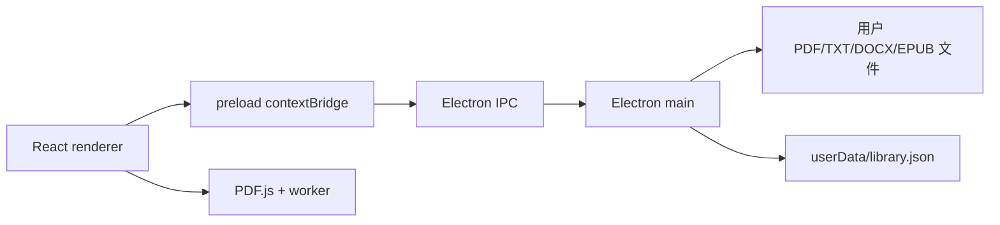

# 书页技术实现文档

## 1. 技术栈与运行方式

| 层次 | 实现 |
| --- | --- |
| 桌面运行时 | Electron 33 |
| 界面 | React 18 + TypeScript |
| 开发与构建 | Vite + electron-vite |
| PDF 解析与渲染 | pdfjs-dist 4 |
| TXT 编码 | chardet + iconv-lite |
| DOCX 正文提取 | yauzl 读取 DOCX ZIP 包并提取 WordprocessingML 正文 |
| EPUB 章节读取 | yauzl 解包，解析 container、OPF manifest/spine、导航文档和 XHTML |
| 本地存储 | Electron `userData/library.json` |
| 类型检查 | TypeScript `tsc --noEmit` |

`package.json` 当前提供 `dev`、`build`、`lint` 和 `test` 脚本。Vitest 测试位于 `tests/`，覆盖 DOCX 文本提取和 EPUB 包结构、spine 顺序、路径解析及无效输入。

## 2. 实际目录结构

```text
elc_book/
├─ electron/
│  ├─ main.ts                 # 主进程、窗口、菜单和 IPC
│  ├─ preload.ts              # contextBridge API
│  ├─ shared-types.ts         # 主进程和 renderer 共享类型
│  └─ services/
│     ├─ file-service.ts      # 导入、读取和文件可用性检查
│     ├─ epub-service.ts      # EPUB ZIP、元数据、目录和章节解析
│     └─ store-service.ts     # library.json 读写
├─ src/
│  ├─ app/App.tsx             # 应用状态、打开书籍会话和页面切换
│  ├─ features/library/       # 书架页面
│  ├─ features/reader/        # 阅读页、标签栏、分栏和设置面板
│  ├─ readers/PdfReader.tsx   # PDF 阅读器
│  ├─ readers/TxtReader.tsx   # TXT/DOCX 纯文本阅读器
│  ├─ readers/EpubReader.tsx  # EPUB 章节阅读器
│  ├─ readers/ReaderNotes.tsx # 共享批注悬浮球和笔记面板
│  └─ styles/global.css       # 全局样式
├─ doc/                       # 项目文档
└─ out/                       # electron-vite 构建产物
```

## 3. 进程架构



主进程负责创建窗口、显示文件选择器、读取本地文件和保存状态。renderer 只通过 `window.bookApi` 访问这些能力。preload 不暴露完整的 `ipcRenderer` 或 Node.js API。

## 4. Electron 配置

窗口使用以下安全边界：

```ts
webPreferences: {
  preload: join(__dirname, '../preload/preload.mjs'),
  nodeIntegration: false,
  contextIsolation: true,
  sandbox: false,
}
```

当前 `sandbox` 必须为 `false`，以保证 electron-vite 打包后的 preload 在本项目 Windows 开发环境中稳定加载；Node 集成仍然关闭，renderer 不能直接访问文件系统。

为兼容部分 Windows 环境的 GPU 进程启动问题，主进程使用软件渲染开关：`disable-gpu`、`disable-gpu-compositing` 和 `in-process-gpu`，并调用 `app.disableHardwareAcceleration()`。这些设置不改变 PDF.js 的高分辨率 canvas 渲染。

开发模式下，electron-vite 通过 `ELECTRON_RENDERER_URL` 加载 renderer。DevTools 默认关闭；设置 `ELECTRON_DEVTOOLS=1` 后才会自动打开。

开发模式下，`src/` 前端代码由 Vite HMR 自动更新。页面没有及时更新时，可使用 `Ctrl + R` 普通刷新，或使用 `Ctrl + Shift + R` 忽略缓存刷新；也可以打开 DevTools 后使用刷新按钮的强制刷新选项。修改 `electron/` 中的主进程或 preload 代码不会通过页面刷新生效，需要停止并重新执行 `npm.cmd run dev`。生产构建修改后，需要重新执行 `npm.cmd run build` 并重启应用。

## 5. 数据模型与存储

`store-service.ts` 通过 `app.getPath('userData')` 定位 `library.json`，文件包含 `books`、`settings`、`bookmarks` 和 `notes` 四个字段。阅读设置包括 TXT 字号/行高、主题和 `readerBackgroundColor`（十六进制颜色）；读取设置时会将默认值合并到旧配置，兼容升级前创建的 `library.json`。书籍 ID 是规范化文件路径 SHA-256 的前 24 位；原文件不会复制到应用目录。

```ts
type BookFormat = 'pdf' | 'txt' | 'docx' | 'epub';

interface BookRecord {
  id: string;
  path: string;
  format: BookFormat;
  title: string;
  size: number;
  modifiedAt: number;
  addedAt: number;
  lastOpenedAt: number;
  available: boolean;
  progress: PdfProgress | TxtProgress | EpubProgress;
}

interface PdfProgress { kind: 'pdf'; page: number; pageCount?: number }
interface TxtProgress { kind: 'txt'; scrollRatio: number } // used by TXT and DOCX
interface EpubProgress { kind: 'epub'; chapterHref: string; scrollRatio: number }
```

PDF 保存页码，TXT/DOCX 保存 `0` 到 `1` 的滚动比例，EPUB 保存章节路径和章节内滚动比例。书签和批注均为独立记录；批注保存 `bookId`、阅读位置、位置标签、可选摘录、批注正文和时间戳。删除书架记录时，同时删除该书的书签和批注。

## 6. IPC 与 preload API

所有 IPC 响应统一为 `{ ok: true, data }` 或 `{ ok: false, error }`。

| 通道 | 用途 |
| --- | --- |
| `library:choose-file` | 打开文件选择器并导入 PDF/TXT/DOCX/EPUB |
| `library:list` | 获取书架并刷新文件可用状态 |
| `library:remove` | 移除书架记录 |
| `book:read-text` | 读取 TXT 或提取 DOCX 正文 |
| `book:read-epub` | 读取 EPUB 并解析章节内容 |
| `book:read-binary` | 读取 PDF 二进制数据 |
| `progress:save` | 保存 PDF 页码或文本阅读器滚动比例 |
| `settings:get/set` | 读取或保存阅读设置 |
| `bookmark:list/save/remove` | 管理书签 |
| `note:list` | 获取指定书籍的批注 |
| `note:save` | 保存书籍位置、摘录和批注正文 |
| `note:remove` | 删除批注 |

主菜单导入完成后，主进程通过 `library:imported` 事件通知 renderer。preload 将这些通道封装为 `window.bookApi` 的 `chooseFile`、`listBooks`、`readText`、`readBinary`、`saveProgress`、设置和书签方法。

## 7. 多书阅读与分栏

多书会话状态保存在 renderer 的 `App` 中，不写入持久化文件：`openBookIds` 记录当前打开的标签，`activeBookId` 表示左栏当前书籍，`splitBookId` 表示右栏书籍。打开第二本书时自动加入会话；阅读页也可以通过“打开书籍”继续导入。右栏选择器允许关闭分栏或从其他已打开书籍中选择右栏内容。

`ReaderPage` 为每个栏位创建独立的 `PdfReader`、`TxtReader` 或 `EpubReader`，因此组件内部的 PDF 文档、canvas、章节、滚动位置、搜索、书签和批注面板状态互不共享。只有左栏启用全局键盘翻页和 `B` 快捷键，避免双栏同时响应同一个按键；右栏仍可通过自身工具栏操作。

## 8. PDF 阅读实现

`PdfReader` 通过 IPC 获取完整 PDF 二进制数据，然后调用 `pdfjsLib.getDocument({ data })`。阅读器只取得当前页；双页模式额外取得下一页，并将两个页面并行渲染到两个 canvas。

阅读器在窗口级别监听键盘事件：PDF 的 `ArrowUp`/`PageUp` 向前翻页，`ArrowDown`/`PageDown` 向后翻页；双页模式每次移动两页。`B` 调用当前阅读位置的书签切换逻辑。焦点位于输入框、选择框或可编辑元素时，不拦截这些按键。

PDF 缩放分为两种模式：

- 适应页面：读取当前页尺寸和 `pdf-scroll` 可用空间，单页或双页分别计算最大可见比例，结果限制在 25% 到 100%；点击按钮会强制重新计算，`ResizeObserver` 在窗口尺寸变化时重新计算。
- 手动缩放：使用工具栏的 `+`、`−` 按 10% 调整，范围为 25% 到 400%。

翻页时复用当前的 canvas 槽位，并在页面布局完成后恢复滚动容器的位置；滚动位置同时保存绝对值和相对比例，减少 PDF 页面尺寸变化造成的回滚。

canvas 的 CSS 尺寸保持 PDF 页面尺寸，实际像素尺寸使用以下策略：

```ts
const outputScale = Math.min(Math.max(devicePixelRatio, 1) * 2, 4);
canvas.width = viewport.width * outputScale;
canvas.height = viewport.height * outputScale;
```

这样可以减少 Windows 125%/150% 缩放和高 DPI 显示器上的文字发虚。PDF 本身是低分辨率扫描图片时，渲染器无法恢复原始图像细节。

## 9. TXT 阅读实现

TXT 由主进程读取原始字节，`chardet.detect` 检测编码，再由 `iconv-lite` 转为 JavaScript 字符串。DOCX 通过 `yauzl` 读取 ZIP 包中的 `word/document.xml`，提取段落、换行和制表符，不加载图片、宏或嵌入内容。两种格式都由 renderer 使用 `white-space: pre-wrap` 展示，并共享滚动进度、书签和搜索功能；DOCX 作为只读纯文本，不保留复杂排版。

## 10. EPUB 阅读实现

`epub-service.ts` 使用已有的 `yauzl` 读取 EPUB ZIP 条目，先从 `META-INF/container.xml` 定位 OPF，再按 manifest 和 spine 确定章节及顺序。目录标题优先从 EPUB 3 nav 文档读取，并兼容 EPUB 2 NCX；两者都没有时使用章节正文标题或文件名。单个 XML/XHTML 条目限制为 64 MB，读取总量限制为 128 MB。章节 HTML 通过 `book:read-epub` IPC 返回 renderer。

`EpubReader` 以章节选择器导航，按章节 href 和滚动比例保存/恢复进度，并提供章节内搜索、书签和批注。渲染前使用 `DOMParser` 解析章节，再通过允许的语义标签列表转换为 React 节点；脚本、样式、媒体、SVG、外链和元素属性不会进入页面。MVP 不渲染 EPUB 图片或自带 CSS，因此复杂排版可能与原书不同。

## 11. 批注实现

`ReaderNotes` 是三类阅读器共享的批注面板。它通过 `note:list` 加载当前书籍的全部批注，通过 `note:save` 保存当前阅读位置、选中文本摘录和批注正文，通过 `note:remove` 删除记录。TXT/EPUB 在内容区域鼠标松开时读取浏览器选区；PDF 使用当前页作为位置，不改写 PDF canvas 或源文件。主进程会限制摘录长度为 1000 个字符，并拒绝空批注。

批注入口使用独立的 `.notes-fab` 悬浮球。组件首次布局时根据当前阅读栏和视口边界计算位置，默认放在阅读栏右侧的可见区域中部；悬浮球使用 `position: fixed`，因此窗口或阅读内容滚动时仍留在视野内。`ResizeObserver` 和窗口 `resize` 事件会重新计算边界，拖动过程中则把位置限制在阅读栏和视口的交集范围内。悬浮球拖动超过阈值后会抑制点击，避免误打开面板。

打开后的 `.notes-panel` 使用阅读器容器内的绝对定位。拖动标题栏时通过全局 `pointermove`/`pointerup` 追踪指针，并把面板限制在阅读区域边界内；关闭面板后保留当前位置，切换书籍时清除位置状态。位置只影响界面交互，不写入 `library.json`。

## 12. 开发与验证

```powershell
npm.cmd install
$env:ELECTRON_RUN_AS_NODE = $null
npm.cmd run dev

npm.cmd run lint
npm.cmd run build
```

启动后应验证：PDF/TXT/DOCX/EPUB 导入，EPUB 章节目录、章节切换、搜索、书签和进度恢复，PDF 单页和双页、适应页面、手动缩放，TXT 编码和搜索，DOCX 正文与搜索，三类阅读器的批注保存/查看/删除，设置持久化，以及文件被移动后的不可用状态。`npm.cmd test` 覆盖 DOCX 与 EPUB 解析服务。

## 13. 当前限制

EPUB 暂不支持书内图片、原始 CSS、音视频、外部链接及复杂排版；批注暂不支持编辑、跳转和导出；PDF 目录、文本选择、云同步、账号、DRM、数据库迁移和安装包配置也尚未实现。
